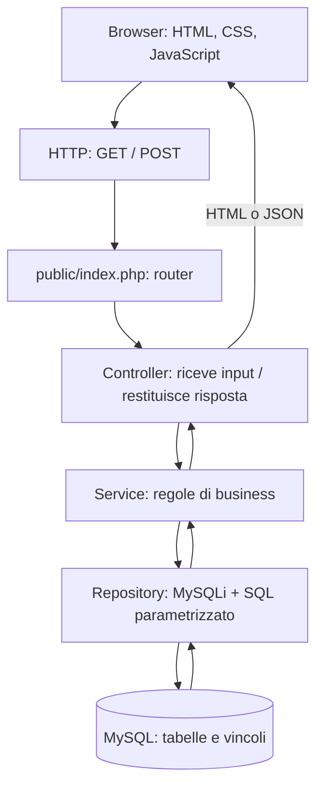

# FitSlot — Guida operativa completa: PHP, MySQL, PHPUnit e GitHub

> **Progetto P3 · Metodi di sviluppo agile · Team LadyTheLemons!**  
> **Versione:** 1.0 — 4 novembre 2026  
> **Destinazione:** `docs/FitSlot_GUIDA_COMPLETA_PHP_SPRINT1.md` nel repository GitHub  
> **Ambito:** organizzazione tecnica, sviluppo, database, test e collaborazione dal primo Sprint in poi.
>
> **Stato della scelta:** questa guida propone **PHP come backend**. Diventa lo standard del team dopo l'approvazione dei quattro componenti. Non è un vincolo imposto dal professore. Se scegliete PHP, la precedente guida basata su Java/Spring Boot diventa una **proposta storica**, non una seconda architettura da mescolare a questa.

Questo documento risponde a quattro domande: **cosa installare, come organizzare il codice, come lavorare insieme senza conflitti e come dimostrare che ogni User Story funziona**. Contiene esempi operativi da adattare ai criteri di accettazione reali. Le regole funzionali ufficiali di FitSlot restano nel Product Backlog e nella documentazione condivisa: **questa guida non sostituisce i requisiti**.

---

<a id="indice"></a>
## Indice

1. [Decisioni tecnologiche e ragioni della scelta](#01-scelte)
2. [Architettura: dal browser alla query SQL](#02-architettura)
3. [Cosa installare su tutti e quattro i computer](#03-installazione)
4. [Struttura completa delle cartelle](#04-cartelle)
5. [Regole per DataModel, Repository, Service e Controller](#05-responsabilita)
6. [Creazione del progetto e configurazione di Composer](#06-composer)
7. [Database minimo dello Sprint 1](#07-database)
8. [Migrazioni SQL e sincronizzazione dei database](#08-migrazioni)
9. [Connessione sicura a MySQL con MySQLi](#09-mysqli)
10. [UE-01: esempio di implementazione a livelli](#10-ue01)
11. [Frontend HTML, CSS e JavaScript](#11-frontend)
12. [Test automatici con PHPUnit](#12-test)
13. [Test d'integrazione con MySQL](#13-integrazione)
14. [GitHub Actions: eseguire i test nelle Pull Request](#14-ci)
15. [GitHub: un branch per ogni User Story](#15-git)
16. [Issue, Pull Request, review e convenzioni](#16-pr)
17. [Piano concreto dello Sprint 1](#17-sprint1)
18. [Regole di dominio FitSlot che guideranno gli Sprint successivi](#18-dominio)
19. [Sicurezza e trattamento dei dati](#19-sicurezza)
20. [Definition of Done e controllo qualità](#20-dod)
21. [Tag, release, consegna e dimostrazione](#21-release)
22. [Problemi frequenti e come risolverli](#22-problemi)
23. [Checklist di avvio da seguire in ordine](#23-checklist)
24. [Fonti ufficiali consultate online](#24-fonti)
25. [Decisioni ancora da approvare in gruppo](#25-decisioni)

---

<a id="01-scelte"></a>
## 1. Decisioni tecnologiche e ragioni della scelta

### Stack proposto

| Componente | Tecnologia | Motivazione |
|---|---|---|
| Backend | **PHP 8.4** | Il gruppo ne conosce già la sintassi; compatibile con PHPUnit 13. |
| Frontend | **HTML5 + CSS3 + JavaScript** | Competenze già presenti; nessuna necessità iniziale di React/Vue. |
| Database | **MySQL 8.4 LTS**, tabelle **InnoDB** | SQL conosciuto dal gruppo, chiavi esterne, transazioni e concorrenza. |
| Connessione SQL | **MySQLi + `mysqli`** | Query parametrizzate e gestione delle transazioni. |
| Librerie PHP | **Composer 2** | L'equivalente pratico di Maven per dipendenze, autoload e comandi. |
| Test | **PHPUnit 13** | Test unitari e d'integrazione eseguibili da terminale e in CI. |
| Variabili locali | **`vlucas/phpdotenv`** | Lettura del file `.env` locale; il file non viene versionato. |
| Repository | **GitHub privato** | Codice condiviso, Issue, Pull Request, review e release. |
| Automazione | **GitHub Actions** | Esecuzione dei test sulle modifiche proposte. |
| IDE | **VS Code** o IDE preferito | Stessi comandi e struttura, indipendenti dall'editor. |

**Perché PHP:** riduce il numero di framework nuovi da imparare. **Non significa che PHP puro sia automaticamente facile**: routing, sessioni, autorizzazioni e sicurezza devono essere progettati e testati. Per il primo Sprint evitiamo di introdurre contemporaneamente Laravel, Docker, microservizi o un secondo backend Java. Se il team preferisce un framework PHP più avanti, la scelta va discussa esplicitamente.

**Vincolo pratico sulle versioni:** PHPUnit 13 richiede PHP **8.4+**. Se un computer usa PHP 8.3, il team deve prima decidere se uniformarsi a PHP 8.4 oppure usare in modo coerente PHPUnit 12. **Non mischiate versioni casuali** nei quattro ambienti. Fonte: [compatibilità ufficiale PHPUnit](https://phpunit.de/supported-versions.html).

### Regole non negoziabili del gruppo

1. **Un solo repository** per l'applicazione; una sola versione ufficiale in `Main`.
2. **Un branch per ogni User Story**: `feature/UE-XX-descrizione`. Fanno eccezione i task tecnici iniziali, che usano `chore/...`.
3. Ogni storia sviluppa il proprio percorso verticale: eventuale SQL + Model + Repository + Service + Controller + interfaccia + test.
4. Le regole di business vanno nel **Service**, le query nel **Repository**. Non scrivere query nei form HTML o nei Controller.
5. Non si unisce una PR senza test, revisione e verifica dei criteri di accettazione.
6. Non si caricano su GitHub password, file `.env`, database locali, dati personali reali o certificati medici reali.
7. Gli **Story Point non sono ore**: lo Sprint accoglie solo le storie realisticamente completabili, anche se sono meno di quattro.

<a id="02-architettura"></a>
## 2. Architettura: dal browser alla query SQL



**Esempio UE-01:** la reception inserisce i dati nel form; il browser invia `POST /api/iscritti`; `UtenteController` controlla il formato della richiesta, `UtenteService` applica i vincoli, `UtenteRepository` esegue `INSERT`; MySQL restituisce l'ID; il Controller risponde con `201 Created` o con un errore comprensibile.

- **DataModel:** definisce *i dati* (`Utente`, in futuro `Abbonamento`, `Corso`, `Prenotazione`).
- **Repository:** legge e scrive *i dati persistenti*, senza decidere le regole del centro.
- **Service:** decide *se* un'operazione è lecita e coordina più repository quando serve.
- **Controller:** adatta HTTP a chiamate dei Service; non contiene SQL.
- **Frontend:** visualizza i risultati; i controlli JavaScript sono utili, ma **non sostituiscono** quelli PHP sul server.

`UtenteService` è un nome ottimo: è esattamente la separazione che volete ottenere. Un Service può usare più Repository; un Controller può usare uno o più Service. Evitate chiamate circolari fra Service.

<a id="03-installazione"></a>
## 3. Cosa installare su tutti e quattro i computer

1. **Git** e un account GitHub autorizzato al repository.
2. **PHP 8.4**, versione da terminale (*CLI*), con estensioni `mysqli`, `mbstring`, `dom`, `xml`, `xmlwriter` e le altre richieste da Composer/PHPUnit.
3. **Composer 2**.
4. **MySQL 8.4 LTS** e un client SQL (MySQL CLI, DBeaver o MySQL Workbench).
5. **VS Code** oppure IDE preferito, con estensione PHP IntelliSense (facoltativa).
6. Browser e terminale. **Non serve Maven** in questa architettura.

Verificare in terminale:

```bash
php -v
php -m
composer --version
git --version
mysql --version
```

Con `php -m` deve comparire **`mysqli`**. Se manca, abilitate l'estensione nella configurazione PHP: il progetto può essere corretto ma non riuscire a collegarsi a MySQL.

**Windows/XAMPP:** controllate quale `php.exe` viene usato da terminale (`where php`). La versione del PHP del browser e quella del terminale possono essere diverse. Verificate anche il MySQL compatibile realmente in uso (XAMPP in alcune installazioni offre MariaDB: **non dichiaratelo MySQL 8.4** senza controllare). Una strada semplice è usare PHP 8.4 e MySQL separati; l'importante è che tutti documentino la stessa combinazione.

Documentazione installazione: [PHP](https://www.php.net/downloads.php), [Composer](https://getcomposer.org/download/), [MySQL](https://dev.mysql.com/downloads/mysql/), [Git](https://git-scm.com/downloads).

<a id="04-cartelle"></a>
## 4. Struttura completa delle cartelle

```text
FitSlot/
├── .github/
│   ├── workflows/
│   │   └── tests.yml
│   └── pull_request_template.md
├── docs/
│   ├── FitSlot_DOCUMENTAZIONE_CONDIVISA.md
│   └── FitSlot_GUIDA_COMPLETA_PHP_SPRINT1.md
├── backlog/
│   └── GruppoXX.xlsx                      # copia del Product Backlog
├── database/
│   ├── migrations/
│   │   ├── 01-create_utenti.sql
│   │   └── 002_....sql                    # futuro, non creare per finta
│   └── seed/
│       └── 01-ruoli.sql
├── public/                                # UNICA cartella pubblica via HTTP
│   ├── index.php                          # front controller / router
│   ├── registrazione.html                 # schermata di esempio UE-01
│   ├── router.php                         # solo per server locale
│   ├── css/
│   │   └── style.css
│   └── js/
│       └── iscritti.js
├── src/
│   ├── Config/
│   │   └── Database.php
│   ├── DataModel/
│   │   ├── Utente.php
│   │   └── Ruolo.php
│   ├── Repository/
│   │   ├── UtenteRepository.php           # interfaccia
│   │   └── MysqliUtenteRepository.php        # query MySQL
│   ├── Service/
│   │   └── UtenteService.php
│   └── Controller/
│       └── UtenteController.php
├── tests/
│   ├── Unit/
│   │   └── UtenteServiceTest.php
│   └── Integration/
│       └── ...                             # da creare quando serve
├── .env.example
├── .env                                  # locale, NON versionato
├── .gitignore
├── composer.json
├── composer.lock                         # DA versionare
├── phpunit.xml
└── README.md
```

### Convenzioni per le classi

- **Namespace** `Ladythelemons\Fitslot\DataModel`, `Ladythelemons\Fitslot\Repository`, `Ladythelemons\Fitslot\Service`, `Ladythelemons\Fitslot\Controller`.
- **PSR-4:** `Ladythelemons\Fitslot\` punta a `src/`; classi e file con lo stesso nome e maiuscole coerenti.
- **Classi:** `Utente`, `UtenteService`; **metodi:** `registraUtente()`, `cercaPerCodice()`; **tabelle:** `utenti`, `utenti_ruoli`.
- **Un file per classe**, proprietà tipizzate, `declare(strict_types=1);` nei nuovi file PHP.
- Gli oggetti del dominio **non devono conoscere** `$_POST`, `$_SESSION`, SQL o il browser.
- Cartelle `vendor/`, `.env` e dump SQL locali **non entrano nel repository**.

<a id="05-responsabilita"></a>
## 5. Regole per DataModel, Repository, Service e Controller

| Livello | Deve fare | Non deve fare |
|---|---|---|
| **DataModel** | Attributi e significato degli oggetti, eventuali invarianti locali | Ricevere HTTP, aprire connessioni SQL |
| **Repository** | Query parametrizzate, mappatura righe/oggetti | Scegliere chi può prenotare, generare HTML |
| **Service** | Validazioni di business, transazioni, coordinamento | Stampare pagine, leggere direttamente `$_POST` |
| **Controller** | Parsing input, risposte HTTP, codici 200/201/400/403/404/409 | SQL, logica dei crediti e blacklist |
| **Frontend** | Form, messaggi, navigazione e interazione | Essere unica protezione per regole/permessi |
| **Tests** | Dimostrare regole e casi limite | Dipendere da dati casuali del DB personale |

**Regola sulle eccezioni:** gli errori prevedibili devono avere un significato preciso (`email duplicata`, `dato non valido`, `non autorizzato`). Il controller li traduce in un codice HTTP appropriato; un errore tecnico interno viene registrato in log **senza mostrare password, SQL o dettagli del server all'utente**.

<a id="06-composer"></a>
## 6. Creazione del progetto e configurazione di Composer

### Passi iniziali, eseguiti UNA sola volta

Nel branch tecnico `chore/setup-iniziale`, una persona crea il progetto. Le altre partecipano alla review e provano a farlo partire dopo il merge.

```bash
mkdir FitSlot
cd FitSlot
git init
composer init
composer require vlucas/phpdotenv
composer require --dev "phpunit/phpunit:^13"
```

Se `composer init` chiede nome e descrizione, potete usare `ladythelemons/fitslot`. **Non cancellate i campi `require` e `require-dev` aggiunti da Composer** per ricopiare l'esempio seguente: modificateli conservando le dipendenze installate.

### Configurazione da ottenere in `composer.json`

```json
{
    "name": "ladythelemons/fitslot",
    "description": "Progetto agile 2026-2027",
    "type": "project",
    "license": "proprietary",
    "require": {
        "php": "^8.4",
        "ext-mysqli": "*",
        "vlucas/phpdotenv": "^5.8"
    },
    "require-dev": {
        "phpunit/phpunit": "^13"
    },
    "autoload": {
        "psr-4": {
            "Ladythelemons\\Fitslot\\": "src/"
        }
    },
    "scripts": {
        "test": "@php vendor/phpunit/phpunit/phpunit",
        "test:unit": "@php vendor/phpunit/phpunit/phpunit --testsuite Unit",
        "db:setup": "@php scripts/db-setup.php",
        "start": "@php -S 127.0.0.1:8000 -t public"
    }
}
```

Dopo aver sistemato il file, eseguire `composer update` **solo durante la configurazione iniziale** per allineare il lock, oppure usare `composer require` per modifiche puntuali. Poi:

```bash
composer dump-autoload
composer validate
composer test
```

All'inizio `composer test` richiede almeno un test nella cartella `tests`: preparate il primo test prima di chiedere che la CI passi. `composer test` è uno **script creato dal team**, non un comando nativo equivalente a Maven senza configurazione.

### Cosa committare

- **SÌ:** `composer.json`, `composer.lock`, sorgenti, test, SQL delle migrazioni.
- **NO:** `vendor/`, `.env`, file del database, log locali, certificati medici e dati reali.

Chi clona il repository usa **`composer install`**, non `composer update`: così vengono installate le versioni precise di `composer.lock`. Fonti: [Composer — Basic usage](https://getcomposer.org/doc/01-basic-usage.md), [Composer — Scripts](https://getcomposer.org/doc/articles/scripts.md).

<a id="07-database"></a>
## 7. Database minimo dello Sprint 1

### Prima l'analisi, poi le tabelle

Le storie candidate sono **UE-01** (registrazione), **UE-02** (ricerca), **UE-03** (login) e **UE-04** (ruoli). Per non perdere tempo, iniziate con **tre tabelle**: `utenti`, `ruoli`, `utenti_ruoli`.

> **Assunzione didattica da approvare:** nell'esempio iniziale ogni iscritto ha un'email univoca. Prima di rendere definitivo lo schema, confrontate tutti i campi obbligatori con i criteri reali della UE-01. In particolare, la registrazione in reception e l'attivazione delle credenziali online non sono necessariamente lo stesso passaggio. Il campo `password_hash` può quindi inizialmente essere `NULL`.

File: `database/migrations/01-create_utenti.sql`

```sql
CREATE TABLE IF NOT EXISTS utenti (
    id BIGINT UNSIGNED AUTO_INCREMENT PRIMARY KEY,
    codice_iscritto VARCHAR(30) NOT NULL UNIQUE,
    nome VARCHAR(100) NOT NULL,
    cognome VARCHAR(100) NOT NULL,
    email VARCHAR(190) NOT NULL UNIQUE,
    password_hash VARCHAR(255) NULL,
    created_at TIMESTAMP DEFAULT CURRENT_TIMESTAMP
) ENGINE=InnoDB;

CREATE TABLE IF NOT EXISTS ruoli (
    id SMALLINT UNSIGNED AUTO_INCREMENT PRIMARY KEY,
    nome VARCHAR(50) NOT NULL UNIQUE
) ENGINE=InnoDB;

CREATE TABLE IF NOT EXISTS utenti_ruoli (
    utente_id BIGINT UNSIGNED NOT NULL,
    ruolo_id SMALLINT UNSIGNED NOT NULL,

    PRIMARY KEY (utente_id, ruolo_id),

    FOREIGN KEY (utente_id)
        REFERENCES utenti(id)
        ON DELETE CASCADE,

    FOREIGN KEY (ruolo_id)
        REFERENCES ruoli(id)
        ON DELETE CASCADE
) ENGINE=InnoDB;
```

File: `database/seed/01-ruoli.sql`

```sql
INSERT IGNORE INTO ruoli (nome)
VALUES
    ('iscritto'),
    ('receptionist'),
    ('istruttore'),
    ('responsabile');
```

**Motivo del ponte `utenti_ruoli`:** un account può avere più ruoli contemporaneamente (es. un istruttore è anche iscritto). Per questo **non** basta una colonna `ruolo` dentro `utenti`.

**Vincoli utili:** `NOT NULL` per i dati obbligatori, `UNIQUE` su codice ed email, `FOREIGN KEY` per evitare associazioni incoerenti. Le tabelle di corsi, abbonamenti e prenotazioni arriveranno con le rispettive User Story, non tutte nello Sprint 1.

<a id="08-migrazioni"></a>
## 8. Migrazioni SQL e sincronizzazione dei database

Ogni membro usa un database locale e gli stessi SQL versionati. Il comando esplicito `composer db:setup` applica prima le migration, poi i seed, ordinati per nome nelle rispettive cartelle. I file iniziali sono `database/migrations/01-create_utenti.sql` e `database/seed/01-ruoli.sql`. `composer start` avvia soltanto il server.

Per creare un'utenza locale dedicata e configurare i permessi, seguire il [README](../README.md). Non usare l'account amministrativo nell'applicazione e non importare manualmente SQL sul DB di sviluppo aggirando il registro.

Il runner usa `schema_migrations`, un lock MySQL per database, checksum SHA-256 con terminatori di riga normalizzati e uno stato di esecuzione. Mantiene compatibili i nomi gia registrati ed estende il registro esistente senza ricrearlo. Non modificare o rinominare SQL gia applicati: aggiungere una nuova migration con nome univoco e ordine concordato nella PR. Non cancellare tabelle o dati dei colleghi.

Per registri precedenti senza checksum serve una verifica manuale di schema e SQL prima della baseline esplicita `composer db:setup -- --registra-impronte`. Il comando registra i checksum mancanti senza eseguire migration o seed; non dimostra quale contenuto sia stato eseguito in passato.

Un errore SQL, un warning o uno stato incompleto interrompono il setup. I DDL MySQL possono produrre commit impliciti e modifiche parziali: non ritentare alla cieca e non rimuovere righe del registro per forzare una riesecuzione. Concordare il recupero con il team dopo aver verificato schema, registro e backup. Dettagli operativi nel [README](../README.md).

<a id="09-mysqli"></a>
## 9. Connessione sicura a MySQL con MySQLi

Copiare `.env.example` in `.env` e configurare DB_HOST, DB_PORT, DB_NAME, DB_USER e DB_PASSWORD per il proprio MySQL locale. Le prime quattro variabili sono obbligatorie e non vuote. Anche DB_PASSWORD deve essere presente, ma puo essere vuota oppure contenere la propria password. Non serve una variabile per distinguere gli ambienti. Non versionare il file locale. `bootstrap.php` carica Composer e phpdotenv; `Database::leggiConfigurazione()` valida i valori senza connettersi al database.

In un entry point:

```php
<?php

use Ladythelemons\Fitslot\Config\Database;

require_once dirname(__DIR__) . '/bootstrap.php';
$connessione = Database::connetti(); // mysqli, errori strict e charset utf8mb4
```

Il file effettivo e `src/Config/Database.php`. Passare la connessione MySQLi ai repository. Per valori esterni usare `prepare()` con parametri o `execute_query($sql, $params)`; mai concatenare input nelle query. Gli identificatori SQL non sono parametri: usare nomi fissi o una lista consentita. Fonte: [PHP MySQLi prepared statements](https://www.php.net/manual/en/mysqli.quickstart.prepared-statements.php).

<a id="10-ue01"></a>
## 10. UE-01: esempio di implementazione a livelli

Il seguente esempio mostra **il disegno del codice**, non una definizione completa dei criteri di UE-01. Prima della PR controllate i campi e le regole del vostro Excel.

### 10.1 DataModel — `src/DataModel/Utente.php`

```php
<?php

declare(strict_types=1);

namespace Ladythelemons\Fitslot\DataModel;

final readonly class Utente
{
    public function __construct(
        public ?int $id,
        public string $codiceIscritto,
        public string $nome,
        public string $cognome,
        public string $email,
    ) {}
}
```

### 10.2 Contratto del Repository — `src/Repository/UtenteRepository.php`

```php
<?php

declare(strict_types=1);

namespace Ladythelemons\Fitslot\Repository;

use Ladythelemons\Fitslot\DataModel\Utente;

interface UtenteRepository
{
    public function esisteEmail(string $email): bool;
    public function salva(Utente $utente): Utente;
}
```

**Perché un'interfaccia?** Il Service può essere testato usando un repository finto senza collegarsi a MySQL; la versione reale usa MySQLi.

### 10.3 Query ? `src/Repository/MysqliUtenteRepository.php`

```php
<?php

declare(strict_types=1);

namespace Ladythelemons\Fitslot\Repository;

use Ladythelemons\Fitslot\DataModel\Utente;
use mysqli;

final class MysqliUtenteRepository implements UtenteRepository
{
    public function __construct(private mysqli $connessione) {}

    public function esisteEmail(string $email): bool
    {
        $risultato = $this->db->execute_query(
            'SELECT 1 FROM utenti WHERE email = ? LIMIT 1', [$email]
        );
        return $risultato->num_rows > 0;
    }

    public function salva(Utente $utente): Utente
    {
        $this->db->execute_query(
            'INSERT INTO utenti (codice_iscritto, nome, cognome, email) VALUES (?, ?, ?, ?)',
            [$utente->codiceIscritto, $utente->nome, $utente->cognome, $utente->email]
        );
        return new Utente(
            (int) $this->db->insert_id,
            $utente->codiceIscritto,
            $utente->nome,
            $utente->cognome,
            $utente->email,
        );
    }
}
```

### 10.4 Logica — `src/Service/UtenteService.php`

```php
<?php

declare(strict_types=1);

namespace Ladythelemons\Fitslot\Service;

use Ladythelemons\Fitslot\DataModel\Utente;
use Ladythelemons\Fitslot\Repository\UtenteRepository;
use DomainException;
use InvalidArgumentException;

final class UtenteService
{
    public function __construct(private UtenteRepository $archivioUtenti) {}

    public function registraUtente(
        string $nome,
        string $cognome,
        string $email,
    ): Utente {
        $nome = trim($nome);
        $cognome = trim($cognome);
        $email = strtolower(trim($email));

        if ($nome === '' || $cognome === '') {
            throw new InvalidArgumentException('Nome e cognome obbligatori');
        }
        if (filter_var($email, FILTER_VALIDATE_EMAIL) === false) {
            throw new InvalidArgumentException('Email non valida');
        }
        if ($this->repository->esisteEmail($email)) {
            throw new DomainException('Email già presente');
        }

        $codice = 'FIT-' . strtoupper(bin2hex(random_bytes(6)));
        $utente = new Utente(null, $codice, $nome, $cognome, $email);

        return $this->repository->salva($utente);
    }
}
```

**Perché questa separazione?** `UtenteService` controlla le regole, ma non sa se i dati siano in MySQL, in memoria o in un database di test. Il Repository esegue effettivamente le query.

**Attenzione alla concorrenza:** il controllo `esisteEmail()` migliora il messaggio, ma **non sostituisce `UNIQUE` nel database**. Due richieste contemporanee possono superare entrambe il precontrollo: la violazione del vincolo SQL va intercettata e tradotta in un errore applicativo coerente. Lo stesso vale per il codice iscritto generato casualmente, pur con probabilità molto bassa di collisione.

### 10.5 Controller — contratto di API suggerito

| Metodo e percorso | Input | Risposta attesa | Errore |
|---|---|---|---|
| `POST /api/iscritti` | JSON con nome, cognome, email | `201` + ID/codice | `400/422` input scorretto; `409` duplicato |
| `GET /api/iscritti?nome=...` | Query string | `200` + risultati | `403` se non autorizzato |
| `GET /health` | Nessuno | `200` + stato | Solo per verifica tecnica |

Il `Controller` deve fare parsing della richiesta, chiamare `UtenteService` e convertire l'esito in HTTP/JSON. **Non ritornate mai `password_hash`, password o dati sanitari nei JSON pubblici**. I permessi del login/reception andranno implementati con UE-03/UE-04 prima di un utilizzo reale o di una pubblicazione in rete.

#### 10.6 Controller minimale per la demo locale

File `src/Controller/UtenteController.php`:

```php
<?php

declare(strict_types=1);

namespace Ladythelemons\Fitslot\Controller;

use Ladythelemons\Fitslot\Service\UtenteService;
use DomainException;
use InvalidArgumentException;
use JsonException;
use mysqli_sql_exception;

final class UtenteController
{
    public function __construct(private UtenteService $servizio) {}

    public function registra(): void
    {
        header('Content-Type: application/json; charset=UTF-8');

        try {
            $dati = json_decode(
                file_get_contents('php://input') ?: '',
                true,
                512,
                JSON_THROW_ON_ERROR
            );
            if (!is_array($dati)) {
                throw new InvalidArgumentException('Formato richiesta non valido');
            }
            foreach (['nome', 'cognome', 'email'] as $campo) {
                if (!isset($dati[$campo]) || !is_string($dati[$campo])) {
                    throw new InvalidArgumentException("Campo {$campo} non valido");
                }
            }

            $utente = $this->service->registraUtente(
                $dati['nome'], $dati['cognome'], $dati['email']
            );
            http_response_code(201);
            echo json_encode([
                'id' => $utente->id,
                'codiceIscritto' => $utente->codiceIscritto,
            ], JSON_THROW_ON_ERROR);
        } catch (JsonException | InvalidArgumentException $errore) {
            http_response_code(422);
            echo json_encode(['errore' => $errore->getMessage()]);
        } catch (DomainException $errore) {
            http_response_code(409);
            echo json_encode(['errore' => $errore->getMessage()]);
        } catch (mysqli_sql_exception $errore) {
            error_log($errore->getMessage());
            $duplicato = ($errore->getCode()) === 1062;
            http_response_code($duplicato ? 409 : 500);
            echo json_encode([
                'errore' => $duplicato ? 'Dato già registrato' : 'Errore interno'
            ]);
        }
    }
}
```

File `public/index.php` (per **sola demo locale**):

```php
<?php

declare(strict_types=1);

use Ladythelemons\Fitslot\Config\Database;
use Ladythelemons\Fitslot\Controller\UtenteController;
use Ladythelemons\Fitslot\Repository\MysqliUtenteRepository;
use Ladythelemons\Fitslot\Service\UtenteService;

require dirname(__DIR__) . '/vendor/autoload.php';
Dotenv\Dotenv::createImmutable(dirname(__DIR__))->safeLoad();

$percorso = parse_url($_SERVER['REQUEST_URI'], PHP_URL_PATH) ?: '/';
$metodo = $_SERVER['REQUEST_METHOD'];

if ($percorso === '/health' && $metodo === 'GET') {
    header('Content-Type: application/json; charset=UTF-8');
    echo json_encode(['stato' => 'ok']);
    exit;
}

if ($percorso === '/api/iscritti' && $metodo === 'POST') {
    $archivioUtenti = new MysqliUtenteRepository(Database::connetti());
    $servizio = new UtenteService($archivioUtenti);
    (new UtenteController($servizio))->registra();
    exit;
}

http_response_code(404);
header('Content-Type: application/json; charset=UTF-8');
echo json_encode(['errore' => 'Percorso inesistente']);
```

Questi frammenti formano un primo percorso didattico coerente con il form di `registrazione.html` e con `public/js/iscritti.js`. **Non pubblicate questo endpoint privo di autenticazione e protezione CSRF**: il suo scopo è verificare l'architettura e i test in locale. Quando implementerete UE-03/UE-04, aggiungerete sessioni, ruoli e autorizzazioni agli endpoint.

<a id="11-frontend"></a>
## 11. Frontend HTML, CSS e JavaScript

Per iniziare bastano una pagina di registrazione e una di ricerca. È perfettamente valido usare HTML/CSS/JS senza un framework frontend.

Esempio sintetico di invio JSON dalla pagina `public/registrazione.html`:

```html
<form id="registrazione">
  <input name="nome" placeholder="Nome" required>
  <input name="cognome" placeholder="Cognome" required>
  <input name="email" type="email" placeholder="Email" required>
  <button type="submit">Registra</button>
</form>
<p id="esito" role="status"></p>
<script src="/js/iscritti.js" defer></script>
```

```js
const form = document.querySelector('#registrazione');
const esito = document.querySelector('#esito');

form.addEventListener('submit', async (event) => {
  event.preventDefault();
  const dati = Object.fromEntries(new FormData(form).entries());

  try {
    const risposta = await fetch('/api/iscritti', {
      method: 'POST',
      headers: { 'Content-Type': 'application/json' },
      body: JSON.stringify(dati)
    });
    const risultato = await risposta.json();
    esito.textContent = risposta.ok
      ? `Iscritto creato: ${risultato.codiceIscritto}`
      : (risultato.errore ?? 'Operazione non riuscita');
  } catch {
    esito.textContent = 'Il server non risponde';
  }
});
```

**Importante:** è un esempio **solo per la demo locale iniziale**. Quando introducete sessioni/autenticazione, aggiungete protezione **CSRF** alle richieste che modificano dati e controllo dei permessi lato server. Non esponete il form di registrazione della reception su un sito pubblico prima di UE-03/UE-04. Nel frontend non usate `innerHTML` con dati inseriti dagli utenti; preferite `textContent`.

### Server locale

File `public/router.php`, utilizzato solo durante lo sviluppo:

```php
<?php

$path = parse_url($_SERVER['REQUEST_URI'], PHP_URL_PATH) ?: '/';
$file = __DIR__ . $path;
if ($path !== '/' && is_file($file)) {
    return false;
}
require __DIR__ . '/index.php';
```

```bash
php -S 127.0.0.1:8000 -t public public/router.php
```

Il server PHP integrato **non è un server di produzione** e va usato soltanto in locale o per demo controllate. Fonte: [manuale PHP — built-in web server](https://www.php.net/manual/en/features.commandline.webserver.php).

<a id="12-test"></a>
## 12. Test automatici con PHPUnit

**Tre tipi di verifica:**

1. **Unit test:** Service isolato da MySQL usando uno *stub* o *mock* del Repository.
2. **Integration test:** Repository con un database `fitslot_test` vero, distinto dal DB di sviluppo.
3. **Verifica end-to-end/manuale:** browser → HTTP → PHP → MySQL → risultato; utile per la Sprint Review.

### Test unitario reale, senza database

File `tests/Unit/UtenteServiceTest.php`:

```php
<?php

declare(strict_types=1);

namespace Tests\Unit;

use Ladythelemons\Fitslot\DataModel\Utente;
use Ladythelemons\Fitslot\Repository\UtenteRepository;
use Ladythelemons\Fitslot\Service\UtenteService;
use DomainException;
use InvalidArgumentException;
use PHPUnit\Framework\TestCase;

final class UtenteServiceTest extends TestCase
{
    public function testRifiutaNomeVuoto(): void
    {
        $archivioUtenti = $this->createStub(UtenteRepository::class);
        $servizio = new UtenteService($archivioUtenti);

        $this->expectException(InvalidArgumentException::class);
        $servizio->registraUtente('', 'Rossi', 'mario@example.com');
    }

    public function testRifiutaEmailDuplicata(): void
    {
        $archivioUtenti = $this->createStub(UtenteRepository::class);
        $archivioUtenti->method('esisteEmail')->willReturn(true);
        $servizio = new UtenteService($archivioUtenti);

        $this->expectException(DomainException::class);
        $servizio->registraUtente('Mario', 'Rossi', 'mario@example.com');
    }

    public function testRegistraUtenteValido(): void
    {
        $archivioUtenti = $this->createStub(UtenteRepository::class);
        $archivioUtenti->method('esisteEmail')->willReturn(false);
        $archivioUtenti->method('salva')->willReturnCallback(
            static fn (Utente $u): Utente => new Utente(
                1, $u->codiceIscritto, $u->nome, $u->cognome, $u->email
            )
        );
        $servizio = new UtenteService($archivioUtenti);

        $utente = $servizio->registraUtente(' Mario ', 'Rossi', 'mario@example.com');

        $this->assertSame(1, $utente->id);
        $this->assertSame('Mario', $utente->nome);
        $this->assertStringStartsWith('FIT-', $utente->codiceIscritto);
    }
}
```

Eseguite:

```bash
composer test:unit
composer test
```

Per fare TDD potete **prima scrivere un test che fallisce**, poi implementare la regola, poi migliorare il codice senza cambiare il comportamento (*red → green → refactor*). Non serve trasformare ogni piccolo pulsante in un test, ma **tutti i criteri di accettazione importanti devono essere verificabili**.

### Test minimi suggeriti per Sprint 1

| User Story | Casi da testare |
|---|---|
| **UE-01** | Registrazione valida; campi mancanti; email duplicata; codice univoco; salvataggio reale. |
| **UE-02** | Cerca per nome, cognome e codice; nessun risultato; più risultati; permessi. |
| **UE-03** | Password corretta/errata; account senza credenziali; logout; sessione. |
| **UE-04** | Reception autorizzata; iscritto non autorizzato; account con più ruoli. |

**Non chiamate una storia “Done” se è stata verificata soltanto la schermata e non i casi limite.**

<a id="13-integrazione"></a>
## 13. Test d'integrazione con MySQL

Per i futuri test d'integrazione creare un database **separato** da `fitslot_dev`. Gli import diretti seguenti riguardano soltanto fixture del DB di test; per lo sviluppo usare il runner documentato nel README:

```bash
mysql -u root -p -e "CREATE DATABASE fitslot_test CHARACTER SET utf8mb4 COLLATE utf8mb4_unicode_ci;"
mysql -u root -p fitslot_test < database/migrations/01-create_utenti.sql
mysql -u root -p fitslot_test < database/seed/01-ruoli.sql
```

### Come funzionano

- L'unit test di `UtenteService` usa un Repository simulato e **non** richiede MySQL.
- L'integration test crea **dati fittizi** in `fitslot_test`, chiama `MysqliUtenteRepository` e verifica che `INSERT`, `SELECT` e vincoli `UNIQUE` funzionino davvero.
- Ogni test deve essere **isolato e ripetibile**. Se necessario, aprite una transazione all'inizio del test e fate `rollback()` alla fine; le istruzioni DDL (`CREATE TABLE`, ecc.) vanno eseguite **prima dei test**, perché in MySQL causano spesso commit impliciti.
- Ogni membro usa credenziali e DB di test propri; **mai eseguire test distruttivi sul DB di sviluppo condiviso o su un database di produzione**.
- Per prenotazioni e crediti, negli Sprint successivi, scrivete anche test con **richieste concorrenti**: i test unitari da soli non verificano il problema dell'ultimo posto.

Documentazione: [PHP MySQLi transactions](https://www.php.net/manual/en/mysqli.begin-transaction.php), [MySQL InnoDB locking reads](https://dev.mysql.com/doc/refman/8.4/en/innodb-locking-reads.html).

<a id="14-ci"></a>
## 14. GitHub Actions: eseguire i test nelle Pull Request

### CI minima consigliata: attivatela nel setup iniziale

Create `.github/workflows/php-tests.yml`:

```yaml
name: FitSlot - PHP Tests

on:
  push:
    branches: [Main]
  pull_request:
    branches: [Main]

permissions:
  contents: read

jobs:
  test:
    runs-on: ubuntu-latest

    steps:
      - name: Checkout
        uses: actions/checkout@v7

      - name: Setup PHP
        uses: shivammathur/setup-php@v2
        with:
          php-version: '8.4'
          extensions: mysqli, mbstring, dom, xml, xmlwriter
          tools: composer:v2
          coverage: none

      - name: Install dependencies
        run: composer install --no-interaction --prefer-dist

      - name: Validate Composer
        run: composer validate --strict --no-check-publish

      - name: Run unit tests
        run: composer test:unit
```

**Questa prima CI esegue volutamente soltanto i test unitari**. In questo modo parte subito senza un server MySQL. Prima di adottarla, assicuratevi che `tests/Unit` contenga almeno un test: una suite vuota non è una verifica utile.

### Quando aggiungerete test d'integrazione

Estendete il job con un servizio MySQL e l'importazione delle migrazioni:

```yaml
# ESEMPIO da integrare nel job precedente, NON un secondo file indipendente
jobs:
  test:
    runs-on: ubuntu-latest
    services:
      mysql:
        image: mysql:8.4
        env:
          MYSQL_DATABASE: fitslot_test
          MYSQL_USER: fitslot_test
          MYSQL_PASSWORD: fitslot_ci_password
          MYSQL_ROOT_PASSWORD: root_ci_password
        ports:
          - 3306:3306
        options: >-
          --health-cmd="mysqladmin ping -h 127.0.0.1 -uroot -proot_ci_password"
          --health-interval=10s
          --health-timeout=5s
          --health-retries=10
    steps:
      - uses: actions/checkout@v7
      - uses: shivammathur/setup-php@v2
        with:
          php-version: '8.4'
          extensions: mbstring, dom, xml, xmlwriter, mysqli
          tools: composer:v2
      - run: composer install --no-interaction --prefer-dist --no-progress
      - name: Importa lo schema di test
        env:
          MYSQL_PWD: fitslot_ci_password
        run: |
          mysql -h 127.0.0.1 -u fitslot_test fitslot_test < database/migrations/01-create_utenti.sql
          mysql -h 127.0.0.1 -u fitslot_test fitslot_test < database/seed/01-ruoli.sql
      - name: Test unitari e integrazione
        env:
          DB_HOST: 127.0.0.1
          DB_PORT: '3306'
          DB_NAME: fitslot_test
          DB_USER: fitslot_test
          DB_PASSWORD: fitslot_ci_password
        run: composer test
```

**Nota operativa:** il secondo frammento è un modello da integrare **quando i test d'integrazione esistono**. I vostri test devono leggere le variabili `DB_*` del job. Il runner GitHub deve avere il client `mysql` disponibile (se manca, installatelo nella workflow). Le password nell'esempio appartengono al **database effimero e isolato della CI**, non sono credenziali reali. Non usate la stessa configurazione per un database pubblico.

**Cosa dovete controllare su GitHub:** aprendo una PR deve comparire un esito verde/rosso. Se i test falliscono non fate il merge. Le Actions sono disponibili anche in repository privati, nei limiti previsti dal piano. Fonti: [setup-php](https://github.com/shivammathur/setup-php), [checkout](https://github.com/actions/checkout), [GitHub Actions](https://docs.github.com/en/actions).

<a id="15-git"></a>
## 15. GitHub: un branch per ogni User Story

### Regola centrale del team

**Ogni User Story ha il proprio branch** e la propria Pull Request. Non create un branch per ogni classe e non lavorate tutti direttamente su `Main`.

Esempi:

```text
Main
├── feature/UE-01-registrazione-iscritto
├── feature/UE-02-ricerca-iscritto
├── feature/UE-03-login
└── feature/UE-04-gestione-ruoli
```

**Eccezione sensata:** `chore/setup-iniziale`, prima delle User Story, per Composer, cartelle, CI e database di base. L'obiettivo è creare una sola infrastruttura comune, non quattro progetti diversi.

### Flusso di lavoro giornaliero

```bash
# Prima di iniziare una nuova storia
git switch Main
git pull origin Main
git switch -c feature/UE-01-registrazione-iscritto

# Dopo una piccola modifica funzionante
composer test:unit
git status
git add src/ tests/ public/ database/
git commit -m "feat(UE-01): implementa registrazione iscritto"
git push -u origin feature/UE-01-registrazione-iscritto
```

Aprire poi la PR verso `Main` su GitHub. Prima del merge:

1. Un compagno legge il codice e controlla i criteri di accettazione.
2. La CI risulta verde.
3. Si verifica che siano incluse eventuali migrazioni SQL.
4. Si correggono i commenti della review.
5. Solo allora si fa il merge e si chiude la Issue.

### Se `Main` è cambiato mentre sviluppavi

```bash
git fetch origin
git switch feature/UE-01-registrazione-iscritto
git merge origin/Main
# risolvi eventuali conflitti, poi riesegui i test
git push
```

Per un team principiante, **`merge origin/Main` è più semplice del rebase di un branch già condiviso**. Non usare `git push --force` per sovrascrivere il lavoro dei compagni.

### Dipendenze fra branch

- **UE-02 dipende dal modello `Utente` e dal Repository** della UE-01.
- **UE-04 dipende dal login/sessione** della UE-03.
- Prima di iniziare due storie dipendenti, concordate **nomi delle classi, campi e firme dei metodi**; scriveteli nella Issue.
- È possibile lavorare in parallelo usando stub/mock, ma **non considerate integrata una storia finché non funziona sulla `Main` reale**.
- Preferite PR piccole. Non mescolate modifiche estranee alla User Story.

<a id="16-pr"></a>
## 16. Issue, Pull Request, review e convenzioni

### Modello di Issue

```markdown
## UE-01 — Registrazione iscritto
**Epic:** E1.1 · **Theme:** T1
**Story Point:** [stima decisa nel Planning Poker]
**Assegnatario:** [nome]

### User Story
[incollare la formulazione approvata nel backlog]

### Criteri di accettazione
- [ ] Criterio 1 ...
- [ ] Criterio 2 ...

### Task tecnici
- [ ] DataModel / SQL
- [ ] Repository + query
- [ ] Service + regole
- [ ] Controller + interfaccia
- [ ] Test unitari / integrazione
- [ ] Demo verificata

### Dipendenze
[es. configurazione iniziale, altro branch già integrato]
```

### Modello di Pull Request (`.github/pull_request_template.md`)

```markdown
## User Story
UE-XX — Titolo

## Cosa cambia
- ...

## Come provarla
1. `composer install`
2. Applicare le migrazioni SQL indicate
3. `composer test`
4. Aprire ... e verificare ...

## Checklist
- [ ] Criteri di accettazione verificati
- [ ] Test unitari aggiunti e verdi
- [ ] Test integrazione dove necessari
- [ ] Nessuna password o dato reale nel commit
- [ ] Nessuna modifica estranea alla storia
- [ ] Revisione di almeno un compagno

Closes #NUMERO_ISSUE
```

### Convenzioni commit

- `feat(UE-01): registra un iscritto`
- `test(UE-01): copre email duplicata`
- `fix(UE-02): ricerca per codice`
- `chore: imposta composer e CI`
- `docs: aggiorna la guida tecnica`

I commit devono descrivere cosa cambia. Inserite **UE-XX** nei nomi dei branch e nelle PR per collegare immediatamente codice e Product Backlog.

<a id="17-sprint1"></a>
## 17. Piano concreto dello Sprint 1

**Scadenza della prima consegna di Sprint: 12 novembre 2026.** La capacità va stabilita dal gruppo dopo Planning Poker e verifica della disponibilità reale; **non presumete che quattro persone debbano completare quattro storie**.

### Prima della prima User Story: setup tecnico comune

**Obiettivo:** ogni compagno riesce a clonare il progetto, eseguire `composer install`, far partire una pagina locale, collegarsi al proprio MySQL ed eseguire almeno un test verde.

**Branch:** `chore/setup-iniziale`. Comprende GitHub, cartelle, Composer, `phpunit.xml` se utile, prima migrazione, connessione MySQLi, `.env.example`, CI, README. **È un task tecnico di setup, non la UE-01 completata.**

### Storie candidate

| Ordine ragionato | Storia | Risultato verificabile | Dipendenze |
|---|---|---|---|
| **1** | **UE-01 — Registrazione iscritto** | Form che salva davvero un iscritto in MySQL e gestisce errori | Setup, schema `utenti` |
| **2** | **UE-02 — Ricerca iscritto** | Ricerca per nome/cognome/codice su dati reali | UE-01 / contratto `UtenteRepository` |
| **3** | **UE-03 — Accesso credenziali** | Login, hash password, sessione e logout | Struttura account |
| **4** | **UE-04 — Funzioni del ruolo** | Autorizzazioni vere lato PHP, multi-ruolo | UE-03, tabelle ruoli |

**Sprint Goal minimo proposto:** “Costruire il primo flusso di gestione dell'anagrafica FitSlot, con registrazione e ricerca su MySQL e test automatici”.

**Nota cruciale sui permessi:** se UE-03/UE-04 non sono ancora completate, la demo di UE-01/UE-02 deve rimanere **strettamente locale, con dati fittizi**. Non presentate quella versione come un sistema sicuro utilizzabile dalla reception su Internet. Inoltre una storia è *Done* solo se soddisfa **tutti i suoi criteri approvati**, comprese le eventuali precondizioni di accesso. Se una storia dipende da login/ruoli non ancora integrati, è possibile che resti **non completata** ai fini dello Sprint.

### Come lavorare in quattro senza bloccarvi

- **Riunione tecnica comune:** progettate schema `utenti`, interfaccia di `UtenteRepository` e convenzioni.
- **Sviluppatore UE-01:** implementa il percorso completo di registrazione nel suo branch.
- **Sviluppatore UE-02:** prepara la ricerca sul contratto condiviso; poi integra sulla `Main` con UE-01.
- **Altri compagni:** possono iniziare UE-03 e i relativi test *solo dopo aver definito le credenziali*, oppure aiutare con CI, test, review e integrazione. Non devono aprire obbligatoriamente una User Story nuova se il carico è già eccessivo.
- **Tutti:** hanno responsabilità condivisa su qualità, review e demo. Nessuna storia è “proprietà esclusiva” di chi la sviluppa.

### Mini-cronoprogramma suggerito

| Fase | Cosa deve essere pronto |
|---|---|
| **Setup** | Repository, Composer, PHPUnit, pagina di prova, DB e primo test |
| **Sviluppo principale** | UE-01 con dati salvati e test; UE-02 in parallelo con contratto condiviso |
| **Integrazione** | Merge PR, migrazioni applicate da tutti, test e demo sul branch `Main` |
| **Chiusura Sprint** | Sprint Backlog aggiornato, presentazione, codice avviabile e release/tag |

Non riempite lo Sprint per raggiungere un totale arbitrario di Story Point. Dovete poter mostrare **funzionalità integrate**, non quattro mezze funzioni sviluppate su branch separati.

<a id="18-dominio"></a>
## 18. Regole di dominio FitSlot che guideranno gli Sprint successivi

Non implementatele tutte nello Sprint 1, ma **tenetele presenti quando progettate le entità**, per non prendere scorciatoie incompatibili con il backlog.

| Area | Regola da non dimenticare | Effetto tecnico futuro |
|---|---|---|
| Utenti | Uno stesso account può avere più ruoli | Tabella ponte `utenti_ruoli`; autorizzazione multi-ruolo |
| Certificato | Prenotazione e ingresso bloccati se assente/non validato/scaduto **alla data dell'attività** | Service di verifica riutilizzabile |
| Crediti | Un credito = **una attività**, non un'intera giornata | Stati `disponibile`, `riservato`, `consumato` |
| Cancellazioni | Prima di 2 h: credito restituito; sotto 2 h/no-show: perso | Calcoli temporali e aggiornamenti idempotenti |
| Abbonamenti illimitati | Penalità di **5 giorni di blocco** delle nuove prenotazioni | Service blocchi indipendente dalle priorità |
| Liste d'attesa | Attesa su attività sovrapposte consentita; conferme sovrapposte vietate | Distinguere stato attesa da prenotazione confermata |
| Subentro | Offerta con scadenza e verifica di idoneità, un candidato alla volta | Transazioni + job di scadenza |
| Presenze | Check-in/out del centro distinti dalla presenza all'attività | Entità e registri separati |
| Congelamento | Massimo 30 giorni cumulabili per abbonamento a tempo | Calcoli su periodi e storico |
| Corsi | Ricorrenza e singole lezioni datate | Modello corso vs istanza della lezione |
| Annullamento | Sotto minimo a -1 h; supplente assente entro inizio | Operazioni temporizzate + notifiche/rimborsi |
| Monitoraggio | Segnalazione se 7 delle ultime 10 lezioni sono annullate | Query sullo storico, non cancellazione automatica |

**Regola architetturale per il futuro:** operazioni composte (prenotazione + riserva credito, subentro + posto + credito) richiedono **transazioni**, controlli di concorrenza e test. Una semplice `SELECT` seguita da `INSERT` senza protezione può consentire due prenotazioni sull'ultimo posto. Per InnoDB il blocco `SELECT ... FOR UPDATE` è uno strumento possibile da valutare sul modello dati concreto: [documentazione MySQL](https://dev.mysql.com/doc/refman/8.4/en/innodb-locking-reads.html).

Le regole complete, con eccezioni e scadenze, sono descritte nel documento del gruppo `FitSlot_DOCUMENTAZIONE_CONDIVISA.md`; non introducete interpretazioni nuove solo perché più facili da programmare.

<a id="19-sicurezza"></a>
## 19. Sicurezza e trattamento dei dati

FitSlot gestisce **dati personali e certificati medici**: anche per un progetto universitario conviene applicare le basi corrette, usando **solo dati fittizi** durante lo sviluppo.

### Regole obbligatorie per il codice

1. **Password:** `password_hash()` per generare l'hash, `password_verify()` per il login; **mai** password in chiaro. Dimensione colonna `VARCHAR(255)` per gli hash.
2. **SQL injection:** solo query MySQLi preparate e parametrizzate per valori esterni, mai `"... WHERE email = '$email'"`.
3. **XSS:** mai stampare input utente non codificato in HTML; usare `htmlspecialchars($valore, ENT_QUOTES | ENT_SUBSTITUTE, 'UTF-8')` nell'output HTML e `textContent` nel browser.
4. **Sessioni:** dopo login valido rigenerare l'identificativo di sessione in modo sicuro; cookie `HttpOnly`, `SameSite`, `Secure` in HTTPS, timeout e logout corretti.
5. **Autorizzazione:** controlli lato server su *ogni endpoint*; nascondere un pulsante non è protezione.
6. **CSRF:** per form/richieste autenticate che modificano dati, usare token CSRF server-side validati; `SameSite` è un'ulteriore misura, non una soluzione universale.
7. **Errori:** all'utente messaggio comprensibile; nel log dettagli tecnici **senza segreti**.
8. **Certificati sanitari:** quando arriveranno, tenerli **fuori da `public/`**, con accesso soltanto dopo verifica dei permessi. Non caricare documenti veri nel repository.
9. **Ambiente locale:** `.env` ignorato da Git, `.env.example` senza credenziali, DB con utenza limitata.
10. **HTTPS:** indispensabile prima di un'eventuale esposizione dell'app in rete; il server `php -S` è soltanto per sviluppo locale.

Fonti: [PHP password_hash](https://www.php.net/manual/en/function.password-hash.php), [password_verify](https://www.php.net/manual/en/function.password-verify.php), [OWASP SQL Injection](https://cheatsheetseries.owasp.org/cheatsheets/SQL_Injection_Prevention_Cheat_Sheet.html), [OWASP CSRF](https://cheatsheetseries.owasp.org/cheatsheets/Cross-Site_Request_Forgery_Prevention_Cheat_Sheet.html), [PHP session_regenerate_id](https://www.php.net/manual/en/function.session-regenerate-id.php).

### `.gitignore` iniziale

```gitignore
/vendor/
/.env
/.env.*
!/.env.example
/.vscode/
/.idea/
/node_modules/
/coverage/
/.phpunit.cache/
*.log
*.sql.gz
*.sqlite
*.sqlite3
.DS_Store
```

**Controllo finale prima del commit:** `git status` e `git diff --cached`; non inviate il `.env` o segreti per errore. Se una password finisce in Git, **non basta cancellarla dal file**: va cambiata immediatamente e va gestita la cronologia compromessa.

<a id="20-dod"></a>
## 20. Definition of Done e controllo qualità

Una User Story è **Done** soltanto quando:

- [ ] Tutti i criteri di accettazione scelti dal gruppo sono verificati e la storia dà il beneficio promesso.
- [ ] Il codice rispetta i livelli `DataModel → Repository → Service → Controller`.
- [ ] Eventuali modifiche SQL sono nelle migrazioni versionate e funzionano su database pulito.
- [ ] Sono presenti test unitari significativi, inclusi casi negativi e limiti.
- [ ] I test d'integrazione sono presenti quando la storia dipende dal comportamento reale di MySQL.
- [ ] `composer test` (o i test concordati nel CI) è verde e non ci sono regressioni note.
- [ ] I controlli di permesso e input sono eseguiti lato PHP.
- [ ] Non sono stati committati segreti o dati reali.
- [ ] Un compagno diverso dall'autore ha esaminato la Pull Request.
- [ ] La PR è stata integrata in `Main` senza conflitti; la funzione parte sull'ultima `Main`.
- [ ] Il gruppo riesce a mostrarla in una demo ripetibile.

**Non Done:** “funziona sul mio PC” ma non su quello degli altri; codice presente soltanto in un branch; test rossi; requisito parzialmente implementato senza concordarne lo spezzamento.

<a id="21-release"></a>
## 21. Tag, release, consegna e dimostrazione

Alla fine dello Sprint:

1. Aggiornate lo Sprint Backlog con **Done / non Done** secondo la Definition of Done.
2. Fate merge delle **sole** PR completate e verificate.
3. Clonate o aggiornate `Main` su un altro PC e ripetete `composer install`, migrazioni, avvio e test.
4. Preparate una **demo breve** con dati fittizi; non affidatevi a database locali già popolati da settimane.
5. Create un **tag/release GitHub** per congelare il codice mostrato alla review, ad esempio `sprint-1`.
6. Nelle note della release indicate le UE completate, istruzioni di avvio, migrazioni e limiti noti.
7. Consegnate gli artefatti richiesti per lo Sprint: Sprint Backlog, codice e presentazione, secondo le istruzioni ufficiali del corso.

```bash
git switch Main
git pull origin Main
composer install
composer test
git tag -a sprint-1 -m "FitSlot Sprint 1"
git push origin sprint-1
```

**Nota:** scegliete il tag soltanto dopo i test e controllate che non esista già. La release può essere creata anche tramite l'interfaccia GitHub. Fonte: [GitHub — Managing releases](https://docs.github.com/en/repositories/releasing-projects-on-github/managing-releases-in-a-repository).

<a id="22-problemi"></a>
## 22. Problemi frequenti e come risolverli

| Sintomo | Causa probabile | Cosa controllare |
|---|---|---|
| `composer: command not found` | Composer non nel PATH | Installazione e terminale riavviato |
| PHP troppo vecchio per PHPUnit | PHP CLI non è 8.4+ | `php -v`; uniformare versione |
| `Class "mysqli" not found` | Manca `mysqli` | `php -m`, `php.ini` usato dalla CLI |
| `Class Ladythelemons\Fitslot\... not found` | Namespace/file PSR-4 errato | Maiuscole e `composer dump-autoload` |
| Accesso negato a MySQL | DB_USER/DB_PASSWORD errati | `.env`, permessi dell'utente DB |
| Tabella non trovata | Migrazione non applicata | Nome DB e lista migrazioni eseguite |
| Duplicate entry su email/codice | Violato vincolo UNIQUE | Messaggio `409`, test caso duplicato |
| `vendor/bin/phpunit` mancante | Dipendenze non installate | `composer install` |
| GitHub Actions fallisce ma in locale no | Versioni/estensioni o DB diversi | Log CI, PHP 8.4, `mysqli`, migrazioni |
| Conflitti su file SQL | Due branch modificano stessa migrazione | Nuovo file SQL, rinumerazione in PR |
| I compagni non vedono la novità | Branch non integrato o browser cache | Controllare `Main`, pull e console |
| PR troppo grande | Più storie mischiate | Separare le modifiche per User Story |

**Regola di diagnosi:** non correggete a caso. Riproducete l'errore, leggete i messaggi, isolate il livello (browser, Controller, Service, Repository o DB), aggiungete un test di regressione se è un bug reale.

<a id="23-checklist"></a>
## 23. Checklist di avvio da seguire in ordine

### Fase A — Decisione comune

- [ ] I quattro approvano PHP come backend, MySQL come DB e PHPUnit come framework di test.
- [ ] Si concorda la versione **PHP 8.4** (o una combinazione alternativa documentata).
- [ ] Si approva la regola **branch per UE + PR + review + CI**.

### Fase B — Setup del repository

- [ ] Repository GitHub privato, 4 collaboratori.
- [ ] Branch `chore/setup-iniziale`.
- [ ] Struttura delle cartelle e `.gitignore`.
- [ ] `composer.json`, `composer.lock`, autoload PSR-4, `composer test`.
- [ ] `.env.example`, connessione MySQLi e DB locale.
- [ ] `01-create_utenti.sql` e seed ruoli.
- [ ] Primo test PHPUnit verde su tutti e quattro i computer.
- [ ] GitHub Actions attiva e PR iniziale integrata in `Main`.

### Fase C — Prima User Story

- [ ] Issue UE-01 con criteri veri del Product Backlog.
- [ ] Branch `feature/UE-01-registrazione-iscritto`.
- [ ] `Utente`, interfaccia `UtenteRepository`, `MysqliUtenteRepository`, `UtenteService`, Controller.
- [ ] Form HTML, input verificati, dati persistenti in MySQL.
- [ ] Test positivi, negativi e di integrazione con DB di test.
- [ ] PR revisionata e integrata.

### Fase D — Scelta del contenuto effettivo dello Sprint

- [ ] Stime Planning Poker condivise e capacità ragionata.
- [ ] UE-02 e poi eventuali UE-03/UE-04 secondo dipendenze e tempo.
- [ ] Nessuna storia lasciata parzialmente implementata ma marcata Done.
- [ ] Demo sul codice `Main` e release/tag Sprint 1.

<a id="24-fonti"></a>
## 24. Fonti ufficiali consultate online

Consultazione effettuata il **4 novembre 2026**. I riferimenti esterni documentano **le tecnologie e le buone pratiche**; la selezione dello stack, i nomi delle classi e il piano Sprint sono **proposte operative per FitSlot**, non prescrizioni di queste fonti o del professore.

1. **Composer — Basic usage, `composer.lock` e PSR-4:** <https://getcomposer.org/doc/01-basic-usage.md>
2. **Composer — Scripts (`composer test`, `@php`):** <https://getcomposer.org/doc/articles/scripts.md>
3. **PHPUnit — Getting started, installazione Composer:** <https://phpunit.de/getting-started.html>
4. **PHPUnit — Compatibilità versioni PHP:** <https://phpunit.de/supported-versions.html>
5. **PHP — MySQLi::prepare e parametri:** <https://www.php.net/manual/en/mysqli.prepare.php>
6. **PHP — Transazioni MySQLi:** <https://www.php.net/manual/en/mysqli.begin-transaction.php>
7. **PHP — Server di sviluppo integrato:** <https://www.php.net/manual/en/features.commandline.webserver.php>
8. **PHP — Password hashing e verifica:** <https://www.php.net/manual/en/function.password-hash.php>, <https://www.php.net/manual/en/function.password-verify.php>
9. **PHP — Session regeneration:** <https://www.php.net/manual/en/function.session-regenerate-id.php>
10. **OWASP — SQL Injection Prevention:** <https://cheatsheetseries.owasp.org/cheatsheets/SQL_Injection_Prevention_Cheat_Sheet.html>
11. **OWASP — CSRF Prevention:** <https://cheatsheetseries.owasp.org/cheatsheets/Cross-Site_Request_Forgery_Prevention_Cheat_Sheet.html>
12. **MySQL 8.4 — InnoDB locking reads:** <https://dev.mysql.com/doc/refman/8.4/en/innodb-locking-reads.html>
13. **GitHub — setup-php:** <https://github.com/shivammathur/setup-php>
14. **GitHub — actions/checkout:** <https://github.com/actions/checkout>
15. **GitHub — Actions:** <https://docs.github.com/en/actions>
16. **GitHub — Gestione release:** <https://docs.github.com/en/repositories/releasing-projects-on-github/managing-releases-in-a-repository>

**Riferimenti interni del gruppo:** Product Backlog `GruppoLady!TheLemons!.xlsx`, `FitSlot_regole_operative_consolidate.md`, `resocontoFinale.md` e documentazione condivisa delle decisioni. In caso di differenza tra una bozza tecnica e un criterio di accettazione approvato, **la storia approvata prevale**; le modifiche ai requisiti vanno discusse nel gruppo.

<a id="25-decisioni"></a>
## 25. Decisioni ancora da approvare in gruppo

Prima di trattare questa guida come definitiva, registrate l'esito di questi punti nella prima Issue tecnica o in una piccola sezione del README:

| Decisione | Proposta | Stato |
|---|---|---|
| Backend | PHP puro strutturato in livelli (niente Java parallelo) | Da approvare |
| PHP e test | PHP 8.4 + PHPUnit 13 | Da approvare |
| Database | MySQL 8.4 LTS, InnoDB, uno locale per membro | Da approvare |
| Gestione librerie | Composer e `composer.lock` versionato | Da approvare |
| Sicurezza iniziale | Demo solo locale con dati fittizi fino a login/ruoli | Da approvare |
| Repository | Un repo privato, `Main` stabile, una PR per User Story | Da approvare |
| Migrazioni | SQL numerato, runner con lock e checksum | Da approvare |
| Sprint 1 | UE-01/UE-02; UE-03/UE-04 solo se sostenibili | Dipende da Planning Poker e capacità |

**Decisione finale da verbalizzare:** “Adottiamo PHP + MySQL + MySQLi + Composer + PHPUnit, con struttura DataModel/Repository/Service/Controller, test automatici e un branch GitHub per ogni User Story. Lo sviluppo del primo Sprint parte da una configurazione comune, poi dalle storie selezionate e realmente completabili.”
